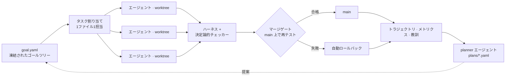

# boulder-swarm（岩を押し上げる群れ）

[English](README.md) · [中文](README.zh-CN.md) · **日本語**

**長期タスクのための目標駆動型マルチエージェントシステム —— シーシュポスと同じく岩を押し続けますが、違うのは岩が本当に頂上に届くことです。**

あなたが決めるのは目標とチェッカーだけです。群れは目標をタスクに分解し、並列のコーディングエージェントに割り振り、検証し、マージまたはロールバックし、次のラウンドを計画します。クラッシュしても、ホストが再起動しても、モデルが落ちても、何週間でも走り続けます。チェッカーが認めない限り、何ひとつ「完了」にはなりません。



## 設計

数分しか動かないエージェントは、どれも問題なく見えます。しかし数日間動かし続けると、いくつかの予測可能なパターンで破綻します。boulder-swarm のすべての構成要素は、そのどれかを防ぐために存在します。

| 長期運用での失敗 | 設計上の判断 |
|---|---|
| **目標のドリフト**：エージェントがタスクをこっそり書き換える | ゴールツリー（L0 最終目標 → L1 マイルストーン → L2 タスク）は凍結されています。planner が作業を追加できるのは `plans/` の提案ファイルだけで、スキーマとポリシーの検査を通る必要があります。戦略は変わっても、目標は変わりません。 |
| **偽の完了**：エージェントが「終わった」と*言う*だけ | すべてのマイルストーンに専用の決定論的チェッカーがあります。完了と認められるのは `pass_rate == 1` **かつ** `total > 0` のときだけで、解析できない 0/0 は成功ではなく失敗として扱います。 |
| **エージェント同士の衝突** | スケジューラが各ファイルに担当者を1人だけ割り当て、各エージェントは自分専用の git worktree で `agent/goal-*` ブランチ上で作業します。 |
| **統合の劣化**：ブランチでは緑なのに、main では赤 | マージゲートはマージ後に main 上でテスト・`tsc`・Biome を再実行し、失敗すればロールバックします。main に入る唯一の経路であり、ロールバック前には stash を取るので、未コミットの作業が消えることはありません。 |
| **進捗の消失**：1回のクラッシュや再起動で数日分の成果が失われる | supervisor のジャーナルはアトミックに書き込まれます（一時ファイル + rename）。中断されたラウンドは破棄扱いにして再キューされ、再起動後は最後のレシートから再開します。トラジェクトリとメトリクスは追記のみで、破損したファイルは隔離され、上書きされることはありません。 |
| **ループでクォータを燃やし尽くす** | 停止の優先順位は「目標達成 > 予算切れ > 進捗なし」です。直前のラウンドとまったく同じフィンガープリントが出たら、1か月空回りする前に停止します。 |

## 2週間連続で動かして、実際に起きたこと

2026年9月下旬から10月中旬にかけて、主に無料枠のモデルで運用しました。

- **キャンペーンの途中でホストが2回再起動しました。** 「黙って落ちていた」ラウンドの原因は、システムのバグではなくホストの再起動だったと突き止め、アーカイブから再開してデータの損失はゼロでした。
- **モデルのエンドポイントが落ちました。** キャンペーンはモデルを切り替えて進行を続け、切り替え後も結果の誠実さは保たれました。
- **群れが自分でラウンドを計画しました。** M8 キャンペーンの13ラウンド（R90–R108）は planner エージェントが提案し、凍結されたゴールツリーに取り込まれました。直近のラウンドでは3つのエージェントが並列に動き、すべてのタスクが同じマージゲートを通って着地しています。
- **システム自身に16件の実際の欠陥が見つかりました。** Windows でしか動かないプロセスツリーの終了処理、自分の履歴を黙って消してしまうジャーナル、ランク23のノイズを「解決済み」として通しかねないスコアリング用マーカー、再起動を止めてしまう生涯予算と1回分の予算の衝突、未マージの成果物を破壊する worktree の再利用などです。どれもシステム自身のゲートや判定器が検出し、テストを先に書いてから修正し、再発しないよう固定しました。
- **エージェントが自分のミスを見つけました。** 自分のスクリーニングツールのバグを指摘し、自分が書いた記録を撤回し、あるときは「あと一歩」の方式を偽りの名前で出すより削除することを選びました。

## キャンペーン一覧

各キャンペーンは L1 マイルストーンで、それぞれ専用のチェッカーを持ちます。ステータス欄は、今日の時点でチェッカーが下した判定そのものです。

| キャンペーン | 目標 | ステータス |
|---|---|---|
| **M8 · F₂ 上の 4×4 行列乗算** | 厳密なランク ≤ 47。AlphaTensor が発表した値（Nature 2022）に、公開済みテンソルを一切取り込まずゼロから到達する | **進行中、現在 49。** 検証済みの2段 Strassen を下限とし、planner が自ら計画したラウンドはこれまでに13回。`goalCheckA.ts` は 1 を返します。 |
| **M5 · 3×3 行列乗算** | 厳密なテンソルランク ≤ 22。1976年に Laderman が 23 を示して以来の未解決問題 | **未解決であり、そのとおり報告しています。** 第1ラウンドから第87ラウンドまで `BEST22=none`。 |
| **M7 · Erdős–Straus パイプライン** | すべての n ≤ 10⁷ について 4/n = 1/x + 1/y + 1/z を検証 | **エンドツーエンドで自律的に解決。** 0.9 秒で全範囲をカバー。 |
| M1–M4 · ウォームアップタスク | アルゴリズム課題 9 問 | 完了。 |

<details>
<summary><b>M8 の詳細</b>：AlphaTensor をゼロから追いかける</summary>

F₂ 上で厳密に成り立つランク49の2段 Strassen を出発点に、R90 以降のすべてのラウンドを planner が提案しています。シード付き反復局所探索、ユニタリ再重み付けとキンク移動を用いたウォーク探索、軌道族の排出と融合、適格性クローズのスイープなどです。ランク ≤ 47 の候補はすべてウィンドウ内で厳密に解かれ、各探索レーンの最良状態は完全な因子ベクトルと安定したハッシュとともに保存されます。各計画には、検証済みの解を出す、残りのサポートを「有界・解なし」として閉じる、予算が尽きたらカバー範囲を正直に報告する、という停止条件が明記されています。詳しくは [`plans/`](plans/) を参照してください。

</details>

<details>
<summary><b>M5 の詳細</b>：50年来の未解決問題に87ラウンド</summary>

- **独立に検証された厳密なランク23の方式を4つ**見つけました。Q 上**でも** F₂ 上でも厳密に成り立つため、このリポジトリ自体が `R ≤ 23` の証拠になっています。
- **体に依存しない反証で、ある経路族をまるごと閉じました。** 4つのアンカー周辺の drop-k/add-j 修復帯はすべて否定され、厳密な件数が残っています。2点削除集合231件、flatDim の生き残り1,986件、k=6 帯の67,000行（うち11,390行は証明済みのクリーク下界で除外）、25,459,896行に及ぶ分割 k=5 帯（599/599 アンカー、4つの対照実験はすべて合格）、そして15,131,424行のワイドアンカー掃引です。
- **スコアは一貫して誠実です。** 第1ラウンドから第87ラウンドまで `BEST22=none`。残る未探索の空間（未スクリーニングの帯、アンカーと21項を共有しないサポート、完全自由係数の問題、境界ランクの経路）は [`src/matmul/FRONTIER.md`](src/matmul/FRONTIER.md) に明記しており、ごまかしていません。

完全なログ：[`src/matmul/CAMPAIGN.md`](src/matmul/CAMPAIGN.md)

</details>

<details>
<summary><b>M7 の詳細</b>：自律的に解決、4世代のソルバーをそれぞれゼロから</summary>

素朴なウィンドウ探索（E1）。エージェントが見つけた**スケーリング補題**（n に解があれば kn にも解がある）によって問題を素数に帰着（E2）。素数専用の高速化（E3）。そしてテーブル上限を撤廃し、10⁷ を 0.9 秒でカバーする最終ソルバー（E4）。各世代は専用の worktree でゼロから書かれ、マージゲートを通って着地し、厳密な BigInt 有理数演算で再検証されています。

</details>

### すべての主張を再現する

```bash
bun src/matmul/tools/verifyAll.ts   # verdict=ALL-CLAIMS-REPRODUCE。ドリフトがあれば非ゼロ終了
bun src/matmul/goalCheck.ts         # M5 ゲート：厳密なランク<=22 の方式が存在するときだけ 0
bun src/matmul/goalCheckA.ts        # M8 ゲート：F2 上で厳密なランク<=47 の方式が存在するときだけ 0
bun src/matmul/scoreboard.ts        # キャンペーン一覧表
```

## 目標から検証済みの成果まで

あなたが書くのは、ゴールツリー、チェッカー、planner のポリシーだけで、それも一度きりです。残りはすべて群れが担います。タスクを提案し、割り振り、コードを書いて実行し、検証し、マージまたはロールバックし、学んだことを記録し、次のラウンドを計画します。M7 はこうしてエンドツーエンドで自律的に解決され、M8 キャンペーンも毎ラウンドこうして自ら計画されています。

## ロードマップ

boulder-swarm は、完全に自律した長期タスクの実現に向けて開発を進めています。

- **M8 の攻略**：F₂ 上で AlphaTensor のランク47にゼロから到達する。すべてのラウンドは群れ自身が計画する。
- **大規模な自律解決**：より長く、より難しいキャンペーンで、人の介入なしに目標から検証済みの成果まで到達する。
- **自己進化する記憶**：台帳からより豊かな教訓を蒸留し、計画にフィードバックする。

## クイックスタート

[Bun](https://bun.sh) が必要です。

```bash
bun install
bun test                                   # 94 ファイル、計 691 テスト
bunx tsc --noEmit && bunx biome check src

bun src/orchestrator/runLoop.ts --workers 12   # 割り当て計画（ドライラン）
bun run run                                    # mock ワーカーでループ全体を実行
bun run run:opencode                           # 無料モデルで実エージェントを実行

# supervisor 付きの長期キャンペーン
bun src/orchestrator/runLoop.ts --supervise --mode opencode --tasks T12 --max-rounds 2

# マイルストーン単位の自律「計画・実行」ループ
bun src/orchestrator/planLoop.ts --milestone M8 --goal-check src/matmul/goalCheckA.ts --rounds 4

bun src/eval/e2eProof.ts                       # エンドツーエンドの証明
bun src/eval/gateProof.ts                      # マージゲートの証明
```

モード：`mock`（高速、モデル不使用）· `opencode`（デフォルトは無料モデル、`OPENCODE_MODEL` で変更可）· `codex`（サブスクリプション）。

## 実験的機能：エージェント主導の再計画

明示的に有効化する拡張機能です。オペレーターが問題の境界と信頼できる進捗チェッカーを固定し、エージェントが*手法*を自ら選びます。エージェントが提案した新しい手法は、既存の手法と同じスナップショットから同じ時間で直接比較され、検証済みのカバー率が向上した場合にのみ採用されます。詳しくは[プロトコル](PROGRESS.md)、[変更レビュー](docs/strategy-changes.zh-CN.md)、[テスト手順](docs/strategy-testing.zh-CN.md)を参照してください。

実モデルでの評価を進めています。

## 対象範囲

- **推定ではなく、厳密さだけを認めます。** すべての主張は決定論的チェッカーで再導出されます。検証済みの解が出るまで、未解決問題は未解決として報告します。
- **体の区別を守ります。** Q/R 上では `19 ≤ R ≤ 23`、F₂ 上では `21 ≤ R_F₂ ≤ 23`。界を体の間で流用することはなく、すべての成果物に対象の体を明記しています。
- **チェック可能な仕事のために作られています。** 決定論的チェッカーが結果を判定できる領域なら、boulder-swarm は力を発揮します。有限領域の探索、厳密性を問うキャンペーン、テスト付きのアルゴリズム・エンジニアリング課題などです。

## リポジトリ構成

```
goal.yaml            # 凍結された L0 → L1 → L2 ゴールツリー + ポリシー
plans/               # planner の提案 —— ゴールツリーに入る唯一の経路
src/orchestrator/    # runLoop、planLoop、planner、スケジューラ、マージゲート、supervisor
src/matmul/          # M5 と M8 のキャンペーン：チェッカー、ゴールゲート、試行、ツール、
                     #   CAMPAIGN.md、FRONTIER.md
src/es4/             # M7 Erdős–Straus のラダー（E1–E4）
src/problems/        # M1–M4 ウォームアップ課題（テストファイルが審判）
src/eval/            # ハーネス、e2eProof、gateProof、リーダーボード
src/recording/       # 追記専用のトラジェクトリ・メトリクス・教訓の書き込み
trajectories/        # コミット済みの実行トレース + supervisor の状態
metrics/             # コミット済みの結果と集計
wiki/                # 累積台帳から蒸留した教訓
docs/                # エージェント主導の再計画に関する設計メモ
```

## こんな人のために

長時間動き続け、**自信満々の文章ではなく検証済みの成果**を出すべきエージェントシステムを作っているなら、このリポジトリは動くエンドツーエンドの実例になります。目標の分解、隔離された並列実行、決定論的な検証、誠実なスコアリング、クラッシュに強い監視、自ら計画するラウンド、そして追記専用の監査証跡。それらを、50年来の未解決問題、記録への挑戦、すでに解決済みの問題という3つの課題に、ひとつのリポジトリで適用しています。

Issue や Discussion を歓迎します。特に、ご自身のゴールツリーとチェッカーで動かした結果の共有を楽しみにしています。

## ライセンス

Apache-2.0。詳しくは [LICENSE](LICENSE) を参照してください。
