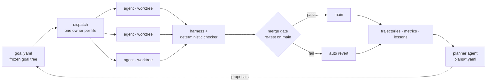

# boulder-swarm

**English** · [中文](README.zh-CN.md) · [日本語](README.ja.md)

**A goal-driven multi-agent system for long-horizon work — like Sisyphus, except the boulder ships.**

You define the goal and the checker. The swarm breaks the goal into tasks, fans
them out to parallel coding agents, verifies, merges or reverts, and plans the
next round — for weeks, through crashes, host reboots and model outages.
Nothing counts as done until the checker agrees.



## The design

Agents that run for minutes look fine. Agents that run for days fail in a few
predictable ways. Every part of boulder-swarm exists to block one of them.

| Long-horizon failure | Design decision |
|---|---|
| **Goal drift** — the agent quietly redefines the task | The goal tree (L0 objective → L1 milestones → L2 tasks) is frozen. The planner can only add work as proposal files in `plans/`, checked against a schema and a policy. The strategy moves; the goal never does. |
| **False completion** — the agent *says* it's done | Every milestone has its own deterministic checker. A task counts only at `pass_rate == 1` **and** `total > 0`; an unparsed 0/0 is a failure, not a success. |
| **Agents stepping on each other** | The scheduler gives each file exactly one owner, and each agent works in its own git worktree on an `agent/goal-*` branch. |
| **Integration rot** — green on the branch, red on main | The merge gate merges, re-runs tests + `tsc` + Biome on main, and reverts on failure. It is the only path to main, and rollbacks are stash-guarded so they never eat uncommitted work. |
| **Lost progress** — crashes and restarts eat days of work | The supervisor journal is atomic (temp file + rename). Interrupted rounds are marked abandoned and requeued; a restart resumes from the last receipt. Trajectories and metrics are append-only, and corrupt files are quarantined, never overwritten. |
| **Burning quota on loops** | Stop precedence is goal > budget > no-progress. A round that repeats the previous round's fingerprint halts the run instead of spinning for a month. |
| **Fabricated provenance** — the agent *claims* continuity it doesn't have | Long-search tasks carry hash-chained state: every receipt's artifact digest must equal the `prevHash` of the next. The checker hands agents the verbatim chain-head digest in their prompts and rejects everything else. Search volume can be exaggerated; a correct smaller network cannot be faked. |

## What a month of continuous runs looked like

From late September to late October 2026, mostly on free-tier models:

- **The host rebooted twice mid-campaign.** Rounds that had died "silently"
  were traced to the reboots, not to a system bug, and the runs resumed from
  their archives with zero data loss.
- **The model endpoint went down — twice, differently.** First a provider
  outage; the campaign switched models and kept going. Later the free
  planner model degraded mid-campaign ("model weather"); the orchestrator
  split planning from execution (`OPENCODE_PLANNER_MODEL` routes planning to
  a stable subscription model while workers stay on the free pool), probes
  planning-grade candidates before promoting them, and reselects after
  timeout rounds. Results stayed honest under every model.
- **The swarm planned its own rounds.** 13 rounds of the M8 campaign (R90–R108)
  were proposed by the planner agent and promoted into the frozen tree; the
  latest rounds ran three agents in parallel, every task landing through the
  same merge gate.
- **19 real defects surfaced in the system itself** — a Windows-only
  process-tree killer, a journal that silently wiped its own history, a scoring
  marker that would have let rank-23 noise pass as solved, a lifetime-vs-per-run
  budget collision that froze restarts, worktree reuse that destroyed un-merged
  round artifacts, agent prompts that crossed the kernel's argv limit and
  killed every spawn for a night, executors fabricating chain-custody hashes
  the prompts never gave them, and a strategy-trial baseline that could never
  verify its own chain head — silently voiding every head-to-head comparison.
  Each one was caught by the system's own gates or judges, fixed test-first,
  and locked in.
- **Agents caught their own mistakes.** They flagged bugs in their own screening
  tools, retracted their own rows, and once deleted a near-miss scheme rather
  than ship it under a false name.

## The campaigns

Each campaign is an L1 milestone with its own checker. The status column is
whatever the checker says today.

| Campaign | Goal | Status |
|---|---|---|
| **M9 · sorting networks, n=11..16** | Beat Batcher's comparator count for every n, then chase the sourced best-known sizes | **Gate passed: all six n beat Batcher; n=13..16 match the best-known (45/51/56/60).** SN08–SN11 now hunt strictly-better-than-best-known (≤44/50/55/59) as checkpoint-chained long searches: verified coverage 5.7M–239.7M candidates per chain, **zero verified improvements — reported as such.** `goalCheck.ts` exits 1. |
| **M8 · 4×4 matrix multiplication over F₂** | Exact rank ≤ 47 — AlphaTensor's number (Nature 2022) — searching from scratch, without importing any published tensor | **Running, at 49.** Verified two-level-Strassen floor; 13 planner-minted rounds so far. `goalCheckA.ts` exits 1. |
| **M5 · 3×3 matrix multiplication** | Exact tensor rank ≤ 22, open since Laderman's 23 (1976) | **Open — and reported as open.** `BEST22=none` from round 1 to round 87. |
| **M7 · Erdős–Straus pipeline** | Verify 4/n = 1/x + 1/y + 1/z for every n ≤ 10⁷ | **Solved autonomously, end to end.** Full coverage in 0.9 s. |
| M1–M4 · warm-up tasks | 9 algorithm tasks | Done. |

<details>
<summary><b>M9 in detail</b> — record-chasing with a custody chain</summary>

SN01–SN07 cleared the gate: for each of n=11..16 a swarm-written network beat
the Batcher odd-even baseline, verified exhaustively under the 0/1 principle,
and n=13..16 landed exactly on the best-known sizes. SN08–SN11 attack the open
frontier (n=13→≤44, n=14→≤50, n=15→≤55, n=16→≤59 — records that have stood for
decades). These run as **checkpoint-chained long searches**: every round extends
a hash-chained state file, a trusted coverage checker re-verifies the chain and
the claimed best network, and method switches must win a head-to-head trial
against the incumbent from the same snapshot. A night of fabricated custody
hashes (agents inventing `prevHash` values) was rejected in full by the chain —
the failure mode is now named in the prompts and the fix is regression-tested.
Score: [`src/sortnet/scoreboard.ts`](src/sortnet/scoreboard.ts); frontier:
[`src/sortnet/FRONTIER.md`](src/sortnet/FRONTIER.md).

</details>

<details>
<summary><b>M8 in detail</b> — chasing AlphaTensor from scratch</summary>

Starting from an exact rank-49 two-level-Strassen floor over F₂, the planner
has proposed every round since R90: seeded iterated local search, walk search
with unitary reweighting and kink moves, orbit-family drain and meld, and
eligibility-close sweeps. Every rank-≤47 candidate is exact-solved in-window;
every lane-best state is checkpointed with full factor vectors and stable
hashes. Each plan states its own stop conditions — ship a verified witness,
close the remaining supports as bounded-no-witness, or report coverage honestly
when the budget runs out. See [`plans/`](plans/).

</details>

<details>
<summary><b>M5 in detail</b> — 87 rounds on a 50-year-old open problem</summary>

- Landed **four independently verified exact rank-23 schemes**, exact over Q
  **and** F₂, so the repo itself witnesses `R ≤ 23`.
- **Closed an entire route family by field-free refutation**: every drop-k/add-j
  repair band around the four anchors is dead, with exact counts — 231
  two-drop sets, 1,986 flatDim survivors, 67,000 rows of the k=6 band (a proven
  clique lower bound killed 11,390 of them), the 25,459,896-row split k=5 band
  (599/599 anchors, four controls green), and the 15,131,424-row wide-anchor
  sweep.
- **Kept score honestly**: `BEST22=none` from round 1 to round 87. The residual
  open space — unscreened bands, supports sharing no 21 terms with the anchors,
  the fully free-coefficient question, border-rank routes — is named in
  [`src/matmul/FRONTIER.md`](src/matmul/FRONTIER.md), not sugar-coated.

Full log: [`src/matmul/CAMPAIGN.md`](src/matmul/CAMPAIGN.md).

</details>

<details>
<summary><b>M7 in detail</b> — solved autonomously, four solver generations, each written from zero</summary>

The direct windowed search (E1); the agent-found **scaling lemma** — if n has a
witness, so does kn — which reduces the problem to primes (E2); a prime-only
accelerator (E3); and a table-cap-free solver covering 10⁷ in 0.9 s (E4). Each
generation was written from zero in its own worktree, landed through the gate,
and re-verified with exact BigInt rational arithmetic.

</details>

### Reproduce every claim

```bash
bun src/matmul/tools/verifyAll.ts   # verdict=ALL-CLAIMS-REPRODUCE; nonzero on drift
bun src/matmul/goalCheck.ts         # M5 gate: exit 0 only if an exact rank<=22 scheme exists
bun src/matmul/goalCheckA.ts        # M8 gate: exit 0 only if an exact rank<=47 scheme over F2 exists
bun src/matmul/scoreboard.ts        # campaign table
```

## From goal to verified result

You write the goal tree, the checkers and the planner policy — once. The swarm
does the rest: it proposes tasks, dispatches them, writes and runs the code,
verifies, merges or reverts, records what it learned, and plans the next round.
That is how M7 was solved autonomously, end to end, and how the M8 campaign
plans every round itself.

## Roadmap

boulder-swarm is under active development toward fully autonomous long-horizon
work. The targeting doctrine: **generation–verification asymmetry is necessary
but not sufficient.** A good campaign target needs three legs — verification is
cheap and deterministic, generation needs mass compute, *and* the frontier is
reachable within the swarm's compute budget. Decades-old world records (M5,
SN08–SN11) fail leg three; they run as integrity stress-tests and lottery
tickets. The next campaigns aim where leg three holds:

- **Sorting networks n=30/31/32** — the only sizes ≤32 whose published size
  records are still bare Batcher merges (Dobbelaere's table shows local-search
  reductions everywhere else: gaps of 37–39 above the lower bounds, never
  attacked). Verification reuses the existing 0/1-principle checker with
  bit-parallel evaluation.
- **Covering designs** — the La Jolla repository (30 years, tens of thousands
  of parameter cells) froze in March 2026 with full data and lower bounds
  published; amateurs still beat cells monthly on its successor site. Many
  cells sit far above their lower bounds. Verification is mechanical and
  seconds-fast.
- **Closing M8**: reaching AlphaTensor's rank 47 over F₂ from scratch, with
  every round planned by the swarm.
- **Autonomous solving at scale**: taking open milestones from goal to verified
  result with no human in the loop, across longer and harder campaigns.
- **Self-improving memory**: richer lessons distilled from the ledger, fed back
  into planning.

## Quickstart

Requires [Bun](https://bun.sh).

```bash
bun install
bun test                                   # 2098 tests across 185 files
bunx tsc --noEmit && bunx biome check src

bun src/orchestrator/runLoop.ts --workers 12   # dispatch plan (dry run)
bun run run                                    # full loop with mock workers
bun run run:opencode                           # live agents on a free model

# long-running supervised campaign
bun src/orchestrator/runLoop.ts --supervise --mode opencode --tasks T12 --max-rounds 2

# autonomous plan-execute loop on a milestone
bun src/orchestrator/planLoop.ts --milestone M8 --goal-check src/matmul/goalCheckA.ts --rounds 4

bun src/eval/e2eProof.ts                       # end-to-end proof
bun src/eval/gateProof.ts                      # merge-gate proof
```

Modes: `mock` (fast, no model) · `opencode` (free tier by default; set
`OPENCODE_MODEL` to override, `OPENCODE_PLANNER_MODEL` to route planning to a
separate model) · `codex` (subscription).

## Agent-directed replanning

The swarm chooses its own *method* while the operator fixes the problem
boundary and a trusted progress checker. A proposed method switch runs
head-to-head against the incumbent from the same snapshot with equal time, and
is kept only if verified coverage improves. Since round 86 of the sorting-
network campaign this is **the only execution path**: every assignment plans,
executes, and reports through the progress protocol, with hash-chained custody
between rounds. See the [protocol](PROGRESS.md), the
[change review](docs/strategy-changes.zh-CN.md) and the
[test handoff](docs/strategy-testing.zh-CN.md).

## Scope

- **Exactness, not estimates.** Every claim is re-derived by a deterministic
  checker; the open problems are reported open until a verified witness exists.
- **Field discipline.** `19 ≤ R ≤ 23` over Q/R and `21 ≤ R_F₂ ≤ 23` over F₂.
  Bounds never transfer between fields; every artifact states its field.
- **Built for checkable work.** boulder-swarm shines wherever a deterministic
  checker can judge the result: finite-domain searches, exactness campaigns,
  algorithm and engineering tasks with tests.

## Repo map

```
goal.yaml            # frozen L0 → L1 → L2 goal tree + policy
plans/               # planner proposals — the only path into the goal tree
src/orchestrator/    # runLoop, planLoop, planner, scheduler, merge gate, supervisor
src/matmul/          # M5 and M8 campaigns: checkers, goal gates, attempts, tools,
                     #   CAMPAIGN.md, FRONTIER.md
src/sortnet/         # M9 sorting networks: 0/1-principle checker, custody-chained
                     #   coverage tools, attempts, CAMPAIGN.md, FRONTIER.md
src/es4/             # M7 Erdős–Straus ladder (E1–E4)
src/problems/        # M1–M4 warm-up tasks (the test file is the judge)
src/eval/            # harness, e2eProof, gateProof, leaderboard
src/recording/       # append-only trajectory, metrics and lesson writers
trajectories/        # checked-in run traces + supervisor state
metrics/             # checked-in results and summaries
wiki/                # lessons distilled from the accumulated ledger
docs/                # design notes for agent-directed replanning
```

## What this is for

If you're building agent systems that should run for a long time and produce
**verified work instead of confident prose**, this repo is a working end-to-end
example: goal decomposition, isolated parallel execution, deterministic
verification, honest scoring, crash-tolerant supervision, self-planned rounds,
and an append-only audit trail — run against a 50-year-old open problem, a
record-chasing one, and a solved one, in the same repo.

Issues and discussions are welcome, especially reports from running your own
goal trees and checkers.

## License

Apache-2.0 — see [LICENSE](LICENSE).
