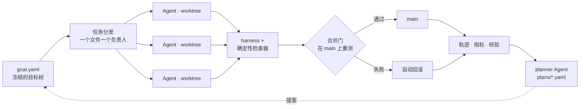

# boulder-swarm（推石者的蜂群）

[English](README.md) · **中文** · [日本語](README.ja.md)

**面向长期任务的目标驱动多智能体系统——和西西弗斯一样推石头，不同的是，石头真的推上了山。**

你来定义目标和检查器。蜂群把目标拆成任务，分发给并行的编码 Agent，验证、合并或回滚，再规划下一轮——一跑就是几周，崩溃、主机重启、模型宕机都拦不住它。检查器不点头，什么都不算完成。



## 设计

只跑几分钟的 Agent 看起来都没问题。一旦要连续跑上几天，它们就会以几种可以预见的方式失败。boulder-swarm 的每一个组件，都是为了挡住其中一种。

| 长期运行中的失败 | 设计决策 |
|---|---|
| **目标漂移**：Agent 悄悄改写了任务 | 目标树（L0 总目标 → L1 里程碑 → L2 任务）是冻结的。planner 只能以 `plans/` 下的提案文件追加工作，并且要通过 schema 和策略校验。策略可以变，目标不会变。 |
| **虚假完成**：Agent *声称*自己做完了 | 每个里程碑都有自己的确定性检查器。只有 `pass_rate == 1` **且** `total > 0` 才算完成；解析不出结果的 0/0 算失败，不算成功。 |
| **Agent 之间互相踩踏** | 调度器保证每个文件只有一个负责人，每个 Agent 在自己的 git worktree 里、在 `agent/goal-*` 分支上工作。 |
| **集成腐烂**：分支上是绿的，合进 main 变红 | 合并门先合并，再在 main 上重跑测试、`tsc` 和 Biome，失败就回滚。它是进入 main 的唯一通道；回滚前会先 stash，绝不吞掉未提交的工作。 |
| **进度丢失**：一次崩溃或重启毁掉几天的成果 | supervisor 日志采用原子写入（临时文件 + rename）。被中断的轮次会标记为作废并重新排队，重启后从最后一份回执继续。轨迹和指标只追加，损坏的文件会被隔离，绝不覆盖。 |
| **在死循环里烧光额度** | 停止优先级为：目标达成 > 预算耗尽 > 无进展。如果一轮的指纹和上一轮完全相同，运行会直接停下，而不是空转一个月。 |

## 连续运行两周，实际发生了什么

2026 年 9 月下旬到 10 月中旬，主要运行在免费模型上：

- **主机在 campaign 中途重启了两次。** 之前那些「无声死掉」的轮次，最终查明是主机重启所致，而不是系统 bug；运行从归档中恢复，没有丢失任何数据。
- **模型接口宕机。** campaign 换了模型继续推进，换模型之后结果依然如实可靠。
- **蜂群自己规划了后续轮次。** M8 campaign 的 13 轮（R90–R108）由 planner Agent 提出并纳入冻结目标树；最近几轮由三个 Agent 并行执行，每个任务都经过同一道合并门。
- **系统自身暴露出 16 个真实缺陷**：只在 Windows 上生效的进程树清理器、会悄悄清空自身历史的日志、可能让秩 23 的噪声被当成「已解决」的计分标记、导致重启卡死的生命周期预算与单次预算冲突、会销毁未合并产物的 worktree 复用。每一个都是被系统自己的检查门或判定器抓出来的，先写测试再修复，然后锁定。
- **Agent 会抓自己的错。** 它们指出过自己筛选工具里的 bug，撤回过自己写下的记录，还有一次宁可删掉一个「差一点就成」的方案，也不肯挂着假名字提交。

## Campaign 一览

每个 campaign 都是一个 L1 里程碑，各自配有检查器。状态一栏以检查器今天的判定为准。

| Campaign | 目标 | 状态 |
|---|---|---|
| **M8 · 4×4 矩阵乘法（F₂ 上）** | 精确秩 ≤ 47，即 AlphaTensor 发表的数字（Nature 2022）；从零搜索，不导入任何已发表的张量 | **进行中，当前 49。** 已验证的两层 Strassen 下界；目前已有 13 轮由 planner 自主规划。`goalCheckA.ts` 返回 1。 |
| **M5 · 3×3 矩阵乘法** | 精确张量秩 ≤ 22，自 1976 年 Laderman 给出 23 以来悬而未决 | **未解决，并如实报告。** 从第 1 轮到第 87 轮，`BEST22=none`。 |
| **M7 · Erdős–Straus 管线** | 对所有 n ≤ 10⁷ 验证 4/n = 1/x + 1/y + 1/z | **端到端自主解决。** 0.9 秒完成全覆盖。 |
| M1–M4 · 热身任务 | 9 道算法题 | 已完成。 |

<details>
<summary><b>M8 详情</b>：从零追赶 AlphaTensor</summary>

从 F₂ 上精确的秩 49 两层 Strassen 下界出发，自 R90 起每一轮都由 planner 提出：带种子的迭代局部搜索、带酉重加权和扭结移动的游走搜索、轨道族的排空与融合，以及资格收敛扫描。每个秩 ≤ 47 的候选都在窗口内做精确求解；每条搜索线的最优状态都连同完整因子向量和稳定哈希一起存档。每份计划都写明了自己的停止条件：交付经过验证的解，或以「有界无解」关闭剩余支撑集，或在预算用尽时如实报告覆盖范围。详见 [`plans/`](plans/)。

</details>

<details>
<summary><b>M5 详情</b>：在 50 年未解的难题上跑了 87 轮</summary>

- 找到了**四个独立验证的精确秩 23 方案**，在 Q **和** F₂ 上都精确成立，仓库本身即可证明 `R ≤ 23`。
- **以与域无关的反驳关闭了一整类路线**：围绕四个锚点的所有 drop-k/add-j 修复带全部被排除，并给出精确计数：231 个双删集、1,986 个 flatDim 幸存者、k=6 带的 67,000 行（其中 11,390 行被一个已证明的团下界直接排除）、25,459,896 行的拆分 k=5 带（599/599 个锚点，四组对照全部通过），以及 15,131,424 行的宽锚点扫描。
- **计分始终诚实**：从第 1 轮到第 87 轮，`BEST22=none`。剩余的开放空间（未筛选的带、与锚点不共享 21 项的支撑集、完全自由系数问题、边界秩路线）都明确列在 [`src/matmul/FRONTIER.md`](src/matmul/FRONTIER.md) 中，没有粉饰。

完整日志：[`src/matmul/CAMPAIGN.md`](src/matmul/CAMPAIGN.md)。

</details>

<details>
<summary><b>M7 详情</b>：自主解决，四代求解器，每一代都从零写起</summary>

直接的窗口搜索（E1）；Agent 发现的**缩放引理**——若 n 有解，则 kn 也有解——把问题归约到素数（E2）；只针对素数的加速器（E3）；以及去掉查表上限、0.9 秒覆盖 10⁷ 的最终求解器（E4）。每一代都在独立的 worktree 里从零写起，经过合并门落地，并用精确的 BigInt 有理数运算重新验证。

</details>

### 复现每一项结论

```bash
bun src/matmul/tools/verifyAll.ts   # verdict=ALL-CLAIMS-REPRODUCE；有任何漂移则非零退出
bun src/matmul/goalCheck.ts         # M5 门：只有存在精确秩<=22 的方案时才返回 0
bun src/matmul/goalCheckA.ts        # M8 门：只有存在 F2 上精确秩<=47 的方案时才返回 0
bun src/matmul/scoreboard.ts        # campaign 总表
```

## 从目标到经过验证的结果

你只需要写一次目标树、检查器和 planner 策略。剩下的都交给蜂群：提出任务、分发、写代码、运行、验证、合并或回滚、记录学到的东西，再规划下一轮。M7 就是这样端到端自主解决的，M8 campaign 的每一轮也是这样由它自己规划的。

## Roadmap

boulder-swarm 正在朝完全自主的长期任务持续开发：

- **拿下 M8**：从零达到 AlphaTensor 在 F₂ 上的秩 47，每一轮都由蜂群自己规划。
- **规模化的自主求解**：在更长、更难的 campaign 中，从目标一路走到经过验证的结果，全程无需人工介入。
- **自我进化的记忆**：从账本中提炼出更丰富的经验，并反哺到规划中。

## 快速开始

需要 [Bun](https://bun.sh)。

```bash
bun install
bun test                                   # 94 个文件，共 691 个测试
bunx tsc --noEmit && bunx biome check src

bun src/orchestrator/runLoop.ts --workers 12   # 分发计划（试运行）
bun run run                                    # 使用 mock worker 跑完整循环
bun run run:opencode                           # 用免费模型跑真实 Agent

# 长期运行、带 supervisor 的 campaign
bun src/orchestrator/runLoop.ts --supervise --mode opencode --tasks T12 --max-rounds 2

# 针对某个里程碑的自主「规划-执行」循环
bun src/orchestrator/planLoop.ts --milestone M8 --goal-check src/matmul/goalCheckA.ts --rounds 4

bun src/eval/e2eProof.ts                       # 端到端证明
bun src/eval/gateProof.ts                      # 合并门证明
```

运行模式：`mock`（快速，不调用模型）· `opencode`（默认免费模型，可用 `OPENCODE_MODEL` 覆盖）· `codex`（订阅制）。

## 实验功能：由 Agent 主导的重新规划

这是一个需要显式启用的扩展：操作者固定问题边界和可信的进度检查器，Agent 自行选择*方法*。Agent 提出的新方法会和现有方法从同一快照出发、在相同时间内正面比较，只有经验证的覆盖率提升时才会被采用。详见[协议](PROGRESS.md)、[完整改动说明](docs/strategy-changes.zh-CN.md)和[测试指南](docs/strategy-testing.zh-CN.md)。

真实模型上的评估正在进行中。

## 适用范围

- **只认精确结果，不接受估计。** 每一项结论都由确定性检查器重新推导；在出现经过验证的解之前，开放问题一律报告为开放。
- **严守域的边界。** Q/R 上为 `19 ≤ R ≤ 23`，F₂ 上为 `21 ≤ R_F₂ ≤ 23`。界不在不同的域之间迁移，每个产物都注明了所属的域。
- **专为可检查的工作而生。** 只要有确定性检查器能判定结果，boulder-swarm 就能发挥所长：有限域搜索、精确性 campaign、带测试的算法与工程任务。

## 目录结构

```
goal.yaml            # 冻结的 L0 → L1 → L2 目标树 + 策略
plans/               # planner 提案——进入目标树的唯一通道
src/orchestrator/    # runLoop、planLoop、planner、调度器、合并门、supervisor
src/matmul/          # M5 和 M8 campaign：检查器、目标门、尝试、工具、
                     #   CAMPAIGN.md、FRONTIER.md
src/es4/             # M7 Erdős–Straus 阶梯（E1–E4）
src/problems/        # M1–M4 热身任务（测试文件就是裁判）
src/eval/            # harness、e2eProof、gateProof、排行榜
src/recording/       # 只追加的轨迹、指标与经验写入器
trajectories/        # 已提交的运行轨迹 + supervisor 状态
metrics/             # 已提交的结果与汇总
wiki/                # 从累计账本中提炼的经验
docs/                # 由 Agent 主导重新规划的设计说明
```

## 这个项目适合谁

如果你在构建需要长时间运行、并且要产出**经过验证的成果、而不是自信的空话**的 Agent 系统，这个仓库就是一个可运行的端到端示例：目标分解、隔离的并行执行、确定性验证、诚实计分、能扛住崩溃的监督、自主规划的轮次，以及只追加的审计记录。它在同一个仓库里，同时面对一道 50 年未解的难题、一个追赶纪录的问题，以及一个已解决的问题。

欢迎提 Issue 和参与讨论，尤其欢迎分享你用自己的目标树和检查器跑出来的结果。

## 许可证

Apache-2.0，详见 [LICENSE](LICENSE)。
